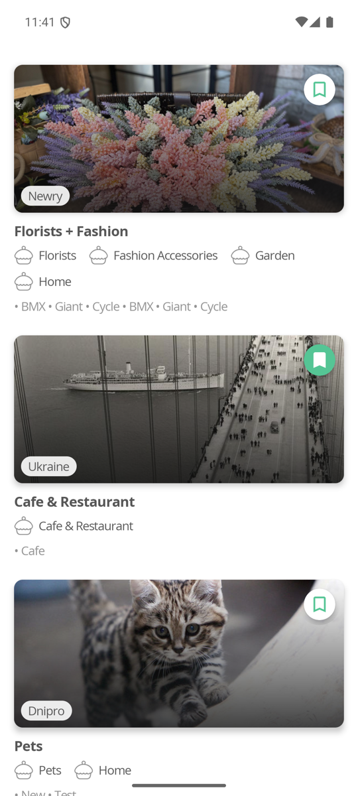

In this challenge, you will create new functionality.

This is a complex task that consists of 2 parts:

1. Build UI according to
   the [Design](https://www.figma.com/file/ghMRg4HaI9l90gFxKwe8LA/Task-Junior-Android?node-id=0%3A1)
   using the Jetpack Compose framework
2. Implement logic to get and display data from the ApiVendors following MVVM architecture

Notes:

- NetworkCategory object contains the image of type .svg
- NetworkVendor object contains images of type .png
- In this project, you will be used mocked data instead of an HTTP request. You can find mocked data
  in the vendors.json file inside the assets resource folder. We decided to simplify this challenge
  to save some time for you and we have implemented mocked data source that you will use to get
  display data. You can find the mocked data source implementation inside the "network" folder. The
  ApiVendors is the data source interface to collect data and the NetworkDataProvider is the
  implementation.
- You should use the latest [stable Android Studio](https://developer.android.com/studio)
  

---

## Solution

- **Architecture:** MVVM. `ApiVendors` → `VendorsRepository` → `VendorsViewModel` (`StateFlow<VendorsUiState>`) → Compose UI.
- **DI:** Hilt.
- **UI:** Jetpack Compose, Material 3, values from the Figma design (Open Sans, colors, spacing). Adaptive grid for larger screens, edge-to-edge.
- **States:** loading, content, empty, error with retry.
- **Images:** Coil with SVG support and placeholders.
- **Bookmark:** toggles the saved state. The mock API is read-only, so the state is kept in memory only.
- **Tests:** `VendorsViewModelTest`.

Notes:
- The build was updated to AGP 8, Kotlin 2.0 and a version catalog.
- `proguard-rules.pro` keeps the network models for Gson in the release build.
- All categories in `vendors.json` share one icon URL, so the category icons look the same.
